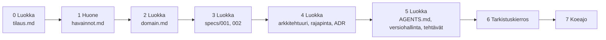

# 05 — Suunnittelu agentille: pelihuoneen varausjärjestelmä

*Lähipäivän työpaja: ei koodia, paitsi päivän lopun koeajo agentilla.*

Kerroilla 1–3 rakensit LeagueHubin ja kirjoitit yhden ominaisuuden specin. Nyt teet saman **järjestelmän kokoisena ja oikeasta tilasta**: kampuksen pelihuoneesta, jonne mennään ensin katsomaan, mitä siellä oikeasti on. Päivän tuotos on kansiollinen markdown-tiedostoja, joista agentti voi rakentaa varausjärjestelmän **arvaamatta**. Lopuksi kokeilet, pystyykö se siihen.

Tänään ei kirjoiteta C#:a. Arkkitehtuurityö, jonka sinä omistat, on **päätökset ja niiden kirjaaminen**. Toteutuksen rivit voi tuottaa avustettuna — päätöksiä ei voi, koska agentti ei ole käynyt huoneessa.

**Työkalut:** muistiinpanot puhelimella tai paperilla huoneessa, sen jälkeen VS Code / Cursor markdownin kirjoittamiseen ja lukemiseen. Koeajossa Copilot, Cursor tai Claude Code. Työ tehdään **yksin**: tarkoitus on treenata omaa ajattelua. Parin kanssa saa keskustella, mutta jokainen kirjoittaa omat tiedostonsa.

**Miten päivä etenee.** Jokainen tiedosto tehdään samalla kaavalla, kolmessa osassa:

1. **Yritä itse** (~25 min). Avaa saman tiedoston malli **toisesta järjestelmästä** — tenttijärjestelmä, [examples/](examples/README.md) — ja kirjoita pelihuoneen versio. Mallista lainataan **rakenne ja tapa perustella, ei lauseita**: tenttijärjestelmän sääntö ei ole pelihuoneen sääntö.
2. **Luokan versio opettajan johdolla** (~15 min). "Nyt kun olette miettineet — mitä kaikkea tähän tulisi?" Rivit kootaan yhdessä, ja jokaisen rivin kohdalla kysytään, mitä agentti tekisi ilman sitä riviä.
3. **Täydennä omaasi** (~5 min). Luokan versio ei korvaa omaa tiedostoasi, se paikkaa aukot. Tiedostossasi säilyy vähintään yksi **oma, perusteltu päätös**, joka eroaa luokan versiosta — esimerkiksi oletus `havainnot.md`:ssä tai ADR:n valinta. Ilman sitä koeajoissa ei ole vertailtavaa.

**Ennen päivää.** Koeajo vaatii: GitHub-tilin, .NET 8 SDK:n ja jonkin agenttityökalun (GitHub Copilot on opiskelijoille maksuton GitHub Educationin kautta; Cursor tai Claude Code käyvät myös). Tarkista, että agentti käynnistyy ja suunnittelutila löytyy, ennen kuin tulet paikalle.

**Palautus.** Tätä tehtävää ei palauteta Moodleen, kuten muitakaan viikkotehtäviä. Repo ja `tarkistus.md`:n kopio jäävät sinulle: sama työtapa ja samat tiedostot ovat lopputehtävän pohja.

---

## Työtapa: spec ensin, koodi agentilta

Tapa, jolla tänään suunnitellaan, on sama jota alan työkalut nimittävät **spec-driven developmentiksi**: päätökset kirjoitetaan tiedostoiksi ennen yhtään koodiriviä, ja agentti toteuttaa niitä vasten yhden rajatun askeleen kerrallaan. Vaiheet ovat kaikissa työkaluissa samat, vain nimet vaihtelevat:

| Vaihe | Kysymys, johon se vastaa | Tiedosto tänään | Muuttuu |
|-------|--------------------------|-----------------|---------|
| **Perussäännöt** (*constitution*) | Mitä ei koskaan tehdä, mistä aloitetaan, milloin pysähdytään | `AGENTS.md`, `docs/arkkitehtuuri.md` | Harvoin |
| **Tarkennus** (*clarify*) | Mitä tilaus jätti sanomatta — ja mikä arvo tai oletus siihen tulee | `docs/tilaus.md`, `docs/havainnot.md` | Kun asiakkaalta kysytään |
| **Kieli ja säännöt** (*domain*) | Mitkä sanat, mitkä säännöt, kenen vastuulla | `docs/domain.md` | Kun sääntö muuttuu |
| **Spec** (*specify*) | Mitä tehdään ja mistä tiedetään, että se on valmis — ei miten | `specs/NNN-*.md` | Uusi tiedosto per ominaisuus |
| **Suunnitelma** (*plan*) | Miten se sijoittuu rakenteeseen ja rajapintaan; miksi näin eikä toisin | `docs/rajapinta.md`, `docs/adr/` | Kun rakenne muuttuu |
| **Tehtävät** (*tasks*) | Missä järjestyksessä, ja mistä jokaisen askeleen valmius todetaan | specin **Tehtävät**-osio | Per spec |
| **Toteutus** (*implement*) | Agentti tekee yhden askeleen; sinä ajat tarkistuksen | koeajo, vaihe 7 | — |

Tärkein ero "hyvään promptiin": prompti katoaa session mukana, tiedosto jää ja seuraava sessio lukee sen. Ihmistiimissä sama tiedosto on se, jonka uusi kehittäjä lukee ensimmäisenä päivänä.

---

## Tekoäly tänään: ensin itse, sitten tarkistajana

Jokaisessa vaiheessa on lopussa kohta **Tekoäly tässä vaiheessa**. Avaa se vasta, kun oma versiosi on kirjoitettu.

**Miksi ensin itse?** Tämän päivän taito on ajattelu: mitä kysyä, mihin sääntö kuuluu ja mikä jäi sanomatta. Tekoäly kirjoittaa tyhjästä aina uskottavan, yleisen kuvauksen varausjärjestelmästä. Se ei ole käynyt huoneessa, joten kuvaus on väärä juuri niissä kohdissa, joilla on merkitystä. Jos et ole itse miettinyt asiaa, et myöskään huomaa, missä se on väärässä. Kun olet ensin kirjoittanut oman versiosi, tekoälyn vastaus on vertailukohta, ei korvike.

Säännöt koko päivälle:

- **Tekoäly ei kirjoita tiedostojasi.** Se kysyy, kyseenalaistaa ja etsii aukkoja. Sinä päätät ja kirjoitat.
- **Tekoäly ei ole asiakas.** Arvoja kuten aukioloaikoja tai ylärajoja se ei voi tietää. Jos se ehdottaa sellaista, se on oletus, ja oletus kirjataan oletukseksi.
- **Pyydä kysymyksiä, älä korjauksia.** "Mitä tästä puuttuu? Kysy minulta, älä korjaa" opettaa enemmän kuin valmis korjattu versio.
- **Kirjaa, mitä otit vastaan ja mitä hylkäsit.** Jokaisen vaiheen tekoälykierroksen tulos kirjataan `docs/tarkistus.md`:hen heti vaiheesta 0 alkaen: mitä se löysi, mitä hyväksyit ja miksi. Vaiheessa 6 tiedosto täydentyy kokonaiseksi. Tällä osoitat, että työnkulku meni oikein ja päätökset ovat sinun.

---

## Teoria tehtävässä — kartta

| Käsite | Yhdellä lauseella | Missä avataan |
|--------|-------------------|---------------|
| **Tarkennus** | Tilauksen aukot kysytään asiakkaalta ennen kuin niistä tehdään oletuksia | Vaihe 0 |
| **Havainnointi** | Tila, ihmiset ja nykyinen tapa toimia katsotaan ennen kuin keksitään yhtään käsitettä | Vaihe 1 |
| **Sanasto (asiakkaan kieli)** | Yksi sana per asia, asiakkaan omilla sanoilla, sama sana koodissa | Vaihe 2 |
| **Invariantti + Paikka** | Sääntö joka ei saa rikkoutua, ja se kerros jossa se tarkistetaan | Vaihe 2 |
| **Tarina** | Yksi käyttäjän tekeminen alusta loppuun: kuka, mitä, miksi | Vaihe 3 |
| **Hyväksymiskriteeri: Given–When–Then** (annettu–kun–niin) | Tarkistus, jonka voi ajaa: lähtötila, tekeminen, odotettu lopputulos | Vaihe 3 |
| **Ei-tavoite** | Ääneen sanottu raja, jota ilman laajuus karkaa | Vaihe 3 |
| **ADR** | Yhden rakennepäätöksen muistio: tilanne, vaihtoehdot, päätös, seuraukset | Vaihe 4 |
| **Rajapinnan lupaus** | Reitit, kentät sanoina, statuskoodit, paginaatio, versio | Vaihe 4 |
| **AGENTS.md** | Repon etusivu agentille: lukujärjestys ja pysähtymissäännöt | Vaihe 5 |
| **Tehtävälista** | Spec pilkottuna pieniksi, erikseen tarkistettaviksi askeliksi | Vaihe 5 |
| **Koeajo** | Agentti saa kuvauksen ja yhden promptin; sinä luet diffin Paikka-saraketta vasten | Vaihe 7 |
| **Spec-driven development** | Päätökset tiedostoiksi ennen koodia; agentti toteuttaa askeleen kerrallaan niitä vasten | Työtapa yllä |

<details>
<summary>Lisämateriaali</summary>

Wiki:
- [Domain-Driven Design](https://github.com/xamk-mire/Xamk-wiki/blob/main/C%23/fin/04-Advanced/Architecture/Domain-Driven-Design.md) — vain taktinen taso: entiteetti, value object, invariantti
- [Clean Architecture](https://github.com/xamk-mire/Xamk-wiki/blob/main/C%23/fin/04-Advanced/Architecture/Clean-Architecture.md) — Dependency Rule
- [DTOs](https://github.com/xamk-mire/Xamk-wiki/blob/main/C%23/fin/04-Advanced/Architecture/DTOs.md) — miksi domain ei vuoda rajapinnasta
- [Repository Pattern](https://github.com/xamk-mire/Xamk-wiki/blob/main/C%23/fin/04-Advanced/Patterns/Repository-Pattern.md)

Kurssin omat:
- *Specistä järjestelmäksi* (kurssin materiaali Moodlessa) — tekniikat sanallisesti; lue osa 3 "Hyvän specin anatomia" ennen vaihetta 2
- [examples/](examples/README.md) — tenttijärjestelmän koko kuvaus: malli jokaisesta tiedostosta
- *03-RepoJaSeeder* (kurssin tehtävä Moodlessa) — osio 5 (spec) ja osio 13 (AGENTS.md)
- *Välitehtävä* (Moodlessa) — sama tiedostojako LeagueHubille

Ulkoiset:
- [agents.md](https://agents.md/) — `AGENTS.md`-tiedoston yleinen muoto, jonka työkalut lukevat
- [GitHub Spec Kit](https://github.com/github/spec-kit) — spec → plan → tasks -työtapa, josta tämän päivän vaiheet on lainattu
- [ADR GitHub organization](https://adr.github.io/) — Architecture Decision Record -pohjat

</details>

---

## Asiakkaan tilaus

Opiskelijakunta ylläpitää kampuksen **pelihuonetta**. Siellä on pelitietokoneita ja konsoleita. Nyt varaukset tehdään Discord-kanavalla ja oven paperilapulla. Se ei toimi: sama kone on luvattu kahdelle, joku istuu koneella koko iltapäivän, ja turnauspäivänä tilassa on ihmisiä, jotka "varasivat koneen viime viikolla".

Asiakas kuvaa tarpeen näin:

> Opiskelijan pitää pystyä varaamaan yksi pelipiste tietyksi ajaksi. Henkilökunnan pitää pystyä järjestämään tapahtuma, joka varaa koko tilan. Kenen tahansa pitää nähdä, mikä on vapaana juuri nyt ja tänään.
>
> Säännöt ovat ehdottomia: samaa pelipistettä ei saa kahdelle samaan aikaan, tapahtuman aikana ei ole yksittäisvarauksia, varaus on aukioloaikojen sisällä, varauksella on yläraja, ja varauksen voi perua vain ennen sen alkua.
>
> Sääntöjen ei pidä olla kiinni tallennustavassa. Ensi vuonna tila laajenee toiselle kampukselle, ja silloin katsotaan uudestaan, mihin data menee.
>
> Seuraava tekijä ei ole käynyt huoneessa eikä muista tätä keskustelua. Ennen kuin se kirjoittaa ohjelman, sen pitää lukea reposta kieli, säännöt ja niiden paikka, osien rajat ja se, miten repoa käsitellään.

Tilauksessa on tahallaan aukkoja: montako pelipistettä, mitkä aukioloajat, mikä on varauksen yläraja, miten opiskelija tunnistetaan, mitä tapahtumalle tapahtuu jos joku on jo varannut koneen sen ajalle. **Ne selvitetään huoneessa ja asiakkaalta** — opettaja vastaa asiakkaan roolissa. Kysymys, jota et kysy, on arvaus, jonka agentti tekee puolestasi.

---

## Mitä rakennamme

Päivän lopussa omassa repossasi on tämä, eikä yhtään riviä C#:a:

```text
AGENTS.md
docs/
├── tilaus.md                  ← asiakkaan tilaus, tarkentavat kysymykset ja vastaukset, mitä huoneessa selvitetään
├── havainnot.md               ← mitä huoneessa nähtiin, nykyinen tapa, huoneessa selvinneet, avoimet + oletukset
├── domain.md                  ← sanasto, käsitteet, invariantit paikkoineen, käyttäytymiset
├── arkkitehtuuri.md           ← osat, suunta, kiellot, elinkaari, ei-tavoitteet
├── rajapinta.md               ← reitit, kentät sanoina, statuskoodit, paginaatio, versio
├── versiohallinta.md          ← haarat, spec ennen koodia, commit, mitä ei repoon
├── images/                    ← huoneen kuvat
└── adr/
    └── 0001-tapahtuma-ja-pelipisteet.md
specs/
├── 001-varaa-pelipiste.md     ← tarina, säännöt + Paikka, hyväksymiskriteerit, ei-tavoitteet, tehtävät
└── 002-jarjesta-tapahtuma.md
```

Työnjako on sama kuin välitehtävässä: yleinen ja pysyvä (`docs/`) erotetaan yksittäisestä muutoksesta (`specs/`). Feature-spec viittaa arkkitehtuuriin, ei toista sitä.

Tuotoksen koe on **vaihe 7**: agentti saa repon ja yhden promptin, ja rakentaa `specs/001`:n. Hyväksytty tulos: agentti kysyi siellä, missä kuvaus oli hiljaa; jokainen sääntö on diffissä siinä kerroksessa, jonka Paikka-sarake sanoo; hyväksymiskriteerit menevät läpi, kun ajat ne itse.

---

## Päivän roadmap



Jokaisella rivillä on se dokumentti, jonka pitää olla **valmiina ennen seuraavaa vaihetta**, ja malli tenttijärjestelmästä. Malli avataan rinnalle, kun kirjoitat — rakenne lainataan, lauseet eivät.

| # | Missä | Valmis dokumentti | Malli (tenttijärjestelmä) | Valmis, kun |
|---|-------|-------------------|---------------------------|-------------|
| 0 | Luokka | `docs/tilaus.md` | [tilaus.md](examples/docs/tilaus.md) | Kysymykset kysytty, vastaukset sanatarkasti, "huoneessa selvitettävät" listattu |
| 1 | Huone | `docs/havainnot.md` + kuvat | [havainnot.md](examples/docs/havainnot.md) | Pelipisteet nimetty, 3 ongelmatapausta, jokaisella avoimella kohdalla oletus |
| 2 | Luokka | `docs/domain.md` | [domain.md](examples/docs/domain.md) | Jokaisella säännöllä Paikka ja syy; VO-päätös kirjoitettu; "vapaana nyt" laskettu näkymä |
| 3 | Luokka | `specs/001-varaa-pelipiste.md`, `specs/002-jarjesta-tapahtuma.md` | [001-suorita-tentti.md](examples/specs/001-suorita-tentti.md), [002-luo-tentti.md](examples/specs/002-luo-tentti.md) | Given–When–Then-kriteerit, myös hylkäyksiä; ei-tavoitteet |
| 4 | Luokka | `docs/arkkitehtuuri.md`, `docs/rajapinta.md`, `docs/adr/0001-*.md` | [arkkitehtuuri.md](examples/docs/arkkitehtuuri.md), [rajapinta.md](examples/docs/rajapinta.md), [adr/0001](examples/docs/adr/0001-maaraaika-suorituksessa.md) | ≥4 konkreettista kieltoa; kentät sanoina; ADR:ssä ≥2 vaihtoehtoa ja seuraukset |
| 5 | Luokka | `AGENTS.md`, `docs/versiohallinta.md`, specin **Tehtävät**-osio | [AGENTS.md](examples/AGENTS.md), [versiohallinta.md](examples/docs/versiohallinta.md), [tehtävät specissä](examples/specs/001-suorita-tentti.md#tehtävät) | Pysähtymissääntö ja tarkistuskomennot; 6–10 askelta, jokaisella oma "valmis kun" |
| 6 | Luokka | `docs/tarkistus.md` valmiiksi (kopio talteen, poistetaan reposta ennen koeajoa) | [tarkistus.md](examples/docs/tarkistus.md) | Oma kierros ensin, sitten tekoälyn kuivaharjoitus; jokaisesta löydöstä päätös ja syy |
| 7 | Luokka | `docs/havainnot.md` → osio **Koeajo** | [havainnot.md → Koeajo](examples/docs/havainnot.md#koeajo) — opettajan demo tällä | Kolme lausetta: missä agentti kysyi, missä arvasi, mikä lause puuttui |

Vaiheissa 2–5 rytmi on sama: **yritä itse → luokan versio opettajan johdolla → täydennä omaasi.** Vaiheessa 0 luokan versio syntyy siinä, kun opettaja vastaa kaikille yhtä aikaa.

---

<details>
<summary>Vaihe 0 — Luokassa: tilaus ja tarkennukset → docs/tilaus.md</summary>

**Miksi tämä vaihe?** Tilaus on asiakkaan ensimmäinen versio, ja siinä on aina aukkoja. Jokainen aukko, jonka löydät nyt, on sääntö tai arvo, jonka agentti muuten keksisi itse. Tämä on työtavan **tarkennus**-vaihe: kysymys on halvin tapa poistaa arvaus.

**Tee.**

1. Lue asiakkaan tilaus yllä. Avaa rinnalle [examples/docs/tilaus.md](examples/docs/tilaus.md) ja katso, millaisia kysymyksiä tenttijärjestelmälle kysyttiin — lainaa kysymysten *laji*, älä kysymyksiä.
2. Kirjoita kysymyksiä, joihin vastaus on arvo tai sääntö — ja kaikki muu, mikä tulee mieleen. Apuna kolme ryhmää:
   - **Tila ja laitteet:** mitä pelipisteitä on, eroavatko ne toisistaan, onko jokin pois käytöstä, mikä on pelipisteen tunniste.
   - **Ihmiset ja nykyinen tapa:** kuka varaa, kuka saa luoda tapahtuman, miten opiskelija tunnistetaan ilman kirjautumista, mitä tapahtuu kun varaaja ei tule.
   - **Säännöt ja rajat:** aukioloajat, varauksen yläraja, saako yhdellä opiskelijalla olla kaksi varausta, mitä tehdään olemassa oleville varauksille kun tapahtuma luodaan niiden päälle, kuinka pitkälle saa varata.
3. **Kysy opettajalta.** Opettaja vastaa asiakkaan roolissa ja vain siihen, mitä kysytään. Kirjaa vastaus sanatarkasti — älä tulkitse vielä. Osa vastauksista on "katsokaa huoneesta": ne menevät omaan listaansa.

Kirjoita `docs/tilaus.md`:

| Osio | Mitä sivulla on |
|------|-----------------|
| Tilaus | Asiakkaan tilaus sellaisenaan, lainauksena |
| Tarkennukset | Jokainen kysymys ja asiakkaan vastaus sanatarkasti |
| Huoneessa selvitettävät | Kysymykset, joihin vastaus oli "katsokaa itse" — tämä on vaiheen 1 lista |
| Kysymättä jääneet | Täydennetään päivän mittaan: asia, joka huomattiin vasta `domain.md`:tä kirjoittaessa. Kysytään silloin |

**Checkpoint.** Jokainen kysymys on sellainen, johon vastaus on **arvo tai sääntö**, ei mielipide. "Onko huone kiva?" ei kelpaa; "mihin kellonaikaan ovi lukitaan?" kelpaa. Kysymättä jäänyt asia ei katoa — siitä tulee agentin arvaus.


<details>
<summary>Tekoäly tässä vaiheessa — vasta oman version jälkeen</summary>

Kun omat kysymyksesi on kirjoitettu, liitä tekoälylle asiakkaan tilaus ja kysymyslistasi:

> Tässä on asiakkaan tilaus ja kysymykset, jotka aion esittää. Mitkä tärkeät kysymykset puuttuvat — erityisesti sellaiset, joiden vastaus on arvo tai sääntö? Älä vastaa niihin itse, listaa vain kysymykset ja kerro, mikä menisi pieleen ilman vastausta.

Vertaa listaa omaasi. Lisää ne kysymykset, joita et itse keksinyt, ja kysy ne opettajalta. **Tekoälyn arvaus vastauksesta ei kelpaa** — vain asiakas tietää.

</details>

</details>

<details>
<summary>Vaihe 1 — Huone: havainnot → docs/havainnot.md</summary>

**Miksi tämä vaihe?** Sanasto otetaan asiakkaan kielestä, ei tutoriaalista. Jos huoneessa sanotaan "piste 4" eikä "resurssi", järjestelmässä on `Pelipiste`, ei `Resource`. Agentti ei voi käydä huoneessa — sinä olet sen silmät. Ja asiakkaan tilaus ja huoneen todellisuus eroavat aina jostain kohdasta; se kohta on tämän vaiheen tärkein löytö.

**Tee.** Menkää huoneeseen `tilaus.md`:n "Huoneessa selvitettävät" -lista mukana. Kirjaa itse; jos liikut parin kanssa, sopikaa kuka katsoo mitäkin, mutta molemmat kirjoittavat omat havaintonsa.

1. **Inventaario.** Laske ja nimeä pelipisteet samalla tavalla kuin tilassa jo tehdään (tarrat, numerot, "se Switch nurkassa"). Kirjaa, mikä erottaa pisteet toisistaan ja onko ero varaamisen kannalta merkityksellinen.
2. **Nykyinen tapa.** Katso oven lappu ja Discord-kanava, jos ne näkyvät. Miten varaus nyt syntyy, miten se näkyy muille, miten se perutaan? Kirjaa **kolme oikeaa ongelmatapausta** asiakkaan sanoin.
3. **Huoneessa selvitettävät.** Käy lista läpi ja kirjaa vastaus jokaiseen. Jos huone kertoo jotain, mikä on ristiriidassa tilauksen kanssa (tilaus sanoi "kymmenen konetta", huoneessa on kahdeksan ja kaksi rikki), kirjaa molemmat — se ratkaistaan luokassa.
4. **Kuvat.** Ota pari kuvaa (pisteet, oven lappu). Ne tulevat `docs/images/`-kansioon — kuva on konteksti, jota teksti ei korvaa.

Kirjoita heti huoneen jälkeen `docs/havainnot.md` (malli: [examples/docs/havainnot.md](examples/docs/havainnot.md)):

| Osio | Mitä sivulla on |
|------|-----------------|
| Tila | Pelipisteet nimineen ja tyyppeineen; aukioloajat; kuka hallinnoi |
| Nykyinen tapa | Miten varataan ja perutaan nyt; kolme ongelmatapausta asiakkaan sanoin |
| Huoneessa selvinneet | `tilaus.md`:n lista vastauksineen; ristiriidat tilauksen kanssa |
| Avoimet | Kysymykset, joihin ei vieläkään ole vastausta — ja mikä **oletus** niille tehdään tänään, merkittynä oletukseksi |

**Checkpoint.** Avoimien listalla ei ole yhtään kohtaa ilman oletusta. Agentti ei lue "jäi auki" — se lukee oletuksen tai keksii oman.


<details>
<summary>Tekoäly tässä vaiheessa — vasta oman version jälkeen</summary>

Tekoäly ei ole käynyt huoneessa, joten se ei voi kirjoittaa havaintoja. Kun `havainnot.md` on valmis, sen voi kuitenkin antaa tarkistettavaksi yhdessä `tilaus.md`:n kanssa:

> Tässä tilaus ja havaintoni. Etsi (1) avoimet kohdat, joilta puuttuu oletus, (2) ristiriidat tilauksen ja havaintojen välillä, (3) havainnot, jotka on kirjattu tulkintana eikä sellaisenaan. Älä keksi uusia havaintoja.

</details>

</details>

<details>
<summary>Vaihe 2 — Sanasto ja säännöt: docs/domain.md</summary>

**Miksi tämä vaihe?** Tämä on sama DDD-kuvaus, jonka kirjoitit LeagueHubille kerralla 2 ja välitehtävään — nyt asiasta, jonka kaikki näkivät samana päivänä. Säännön paikka ratkaistaan edelleen yhdellä kysymyksellä: **mitä tietoa tarkistus tarvitsee?** Yhden olion oma data → entiteetti tai value object. Haku tai toinen olio → use case.

**Tee.** Kirjoita `docs/domain.md`:

| Osio | Mitä sivulla on |
|------|-----------------|
| Sanasto | Asiakkaan sanat ja yksi lause kutakin: pelipiste, varaus, tapahtuma, varaaja, aukioloaika, "vapaana nyt". Jos huoneessa käytettiin eri sanaa kuin tilauksessa, valitse huoneen sana ja kirjaa valinta |
| Käsitteet | Kentät sanoina. Pelipiste: tunniste, tyyppi, käytössä/pois. Varaus: pelipiste, varaaja, aikaväli, tila. Tapahtuma: nimi, järjestäjä, aikaväli. Kirjaa itse, mitä huoneessa selvisi |
| Invariantit | **Jokainen tilauksen sääntö omalla rivillään** ja sen Paikka + miksi. Lisää ne säännöt, jotka selvisivät vasta huoneessa |
| Arvo vai luku | Mikä on value object ja mikä jää pelkäksi kentäksi — ja miksi. Vihje: kaksi kellonaikaa, joilla on yhdessä sääntö, on eri asia kuin pelipisteen numero |
| Laskettu näkymä | "Vapaana nyt / tänään" ei ole tallennettu olio. Sano, mistä se lasketaan ja miksi sitä ei tallenneta — sama syy kuin LeagueHubin sarjataulukolla |
| Käyttäytymiset | Varaa pelipiste, peru varaus, järjestä tapahtuma, katso vapaat. Kullekin: kuka aloittaa, mitkä invariantit sitovat, mitä se **ei** tee |
| Yksi päätös | Kaksi–kolme lausetta: mikä sääntö on entiteetissä ja mikä use casessa, ja miksi ne eivät ole samassa paikassa |

**Checkpoint.** Lue jokainen sääntö ja kysy: "mitä tietoa tämä tarkistus tarvitsee?" Jos vastaus ei näy rivin perustelusta, kirjoita se. *Halutessasi* peitä Paikka-sarake ja anna vierustoverin sijoittaa säännöt — omassa ajattelussa on usein aukkoja, joita ei itse näe. Jos hän sijoittaa säännön eri paikkaan kuin sinä, perustelu puuttuu riviltä. "Päällekkäinen varaus" on tämän päivän vaikein rivi: se tarvitsee haun, ja se koskee sekä varauksia että tapahtumia.


<details>
<summary>Tekoäly tässä vaiheessa — vasta oman version jälkeen</summary>

Kun oma `domain.md` on kirjoitettu ja luokan versio käyty, anna tekoälylle `tilaus.md`, `havainnot.md` ja oma `domain.md`:

> Käy läpi invariantit. Jokaiselle: onko Paikka perusteltu kysymyksellä "mitä tietoa tarkistus tarvitsee"? Kerro, jos sijoittaisit jonkin toisin ja miksi. Etsi myös havainnoista sääntö, joka ei ole päätynyt domain.md:hen. Kysy minulta, älä korjaa tiedostoa.

Jos tekoäly on eri mieltä Paikasta, älä vaihda automaattisesti. Mieti ensin, kumpi perustelu kestää — ja kirjaa vastaus.

</details>

</details>

<details>
<summary>Vaihe 3 — Tarinat ja hyväksymiskriteerit: specs/001 ja 002</summary>

**Miksi tämä vaihe?** Kerran 3 seeder-spec päättyi riviin `joukkueet 3/3, pelaajat 3/3, ottelut 2/2`. Se oli hyvä, koska sen saattoi ajaa. Tänään sama vaatimus kirjoitetaan muotoon, jonka sekä asiakas, agentti että testi ymmärtävät samalla tavalla: **Given – When – Then** (annettu – kun – niin). Se on alan yleisin hyväksymiskriteerin muoto, ja samaa muotoa käyttävät myös testityökalut. *Given* on lähtötila, *When* on yksi tekeminen, *Then* on lopputulos, jonka voi todeta.

**Tee.** Kirjoita `specs/001-varaa-pelipiste.md` ja `specs/002-jarjesta-tapahtuma.md`. Molemmissa sama runko:

| Osio | Mitä sivulla on |
|------|-----------------|
| Tarina | Yksi kappale: kuka, mitä, miksi — asiakkaan sanoin. "Opiskelijana haluan varata pisteen 4 torstaiksi klo 14–16, jotta…" |
| Käsitteet | Vain viittaus `docs/domain.md`:n sanastoon. Ei uusia sanoja tänne |
| Tekemiset | Mitä tässä muutoksessa voi tehdä: luo varaus, peru varaus, katso vapaat. Kullekin onnistuminen ja epäonnistuminen sanoina |
| Säännöt + Paikka | Vain ne invariantit, jotka tätä ominaisuutta sitovat, ja viittaus domain.md:n riviin. Ei kopiota |
| Hyväksymiskriteerit | Given–When–Then-tapauksia, myös hylkäyksiä. Esimerkki muodosta: *Given: piste 4 on vapaa torstaina 14–16. When: opiskelija 123 varaa sen 14–16. Then: varaus syntyy ja piste 4 ei ole enää vapaa sillä välillä.* |
| Ei-tavoitteet | Mitä tämä spec ei tee: ei muistutusta, ei maksua, ei toistuvaa varausta, ei kirjautumista… Kirjaa ne, jotka asiakas sanoi, ja ne, jotka itse päätit |

Spec 002:ssa on tämän päivän kiperin kohta: **mitä tapahtuu olemassa oleville varauksille, kun tapahtuma luodaan niiden päälle?** Hylätäänkö tapahtuma, perutaanko varaukset, vai jotain muuta? Asiakas vastasi tähän luokassa tai huoneessa — tai jätti sen sinun ehdotettavaksesi, ja silloin oletus on `havainnot.md`:ssä. Kirjoita vastaus hyväksymiskriteeriksi. Tämä on vaiheen 4 ADR:n aihe.

**Checkpoint.** Jokaisen kriteerin *Then*-osan voi todeta yhdellä HTTP-kutsulla tai yhdellä katseella vastaukseen. "Varaus toimii oikein" ei ole kriteeri. "Toinen varaus samalle pisteelle samalle välille hylätään ja vastaus kertoo syyn" on.


<details>
<summary>Tekoäly tässä vaiheessa — vasta oman version jälkeen</summary>

Kun omat specit on kirjoitettu:

> Tässä domain.md ja spec. (1) Mitkä hylkäystapaukset puuttuvat — jokaisesta säännöstä pitäisi olla ainakin yksi? (2) Mikä Then-osa ei ole todettavissa yhdellä HTTP-kutsulla tai yhdellä katseella? (3) Mitä agentti todennäköisesti tekisi, jota ei-tavoitteet eivät nyt kiellä?

Hyvä lisäkoe: kirjoita itse Given–When–Then säännölle, jolta se puuttuu, ja pyydä vasta sitten tekoälyä kirjoittamaan sama. Vertaa.

</details>

</details>

<details>
<summary>Vaihe 4 — Rakenne, rajapinta ja yksi päätös: arkkitehtuuri.md, rajapinta.md, ADR</summary>

**Miksi tämä vaihe?** Rakenteen kuvaus on sama kuin välitehtävässä, joten tämä on kertaus — mutta rajapinta ja ADR ovat uusia tiedostoja. Rajapinnan lupaukset (DTO, validointi, Result, paginaatio, versio) opit **vaatimaan** *Specistä järjestelmäksi* -materiaalin osassa 2, vaikka niitä ei ole vielä koodattu. ADR on tapa kirjata **yksi rakennepäätös** niin, että puolen vuoden päästä ihminen tai seuraava agenttisessio tietää, miksi tehtiin näin eikä toisin.

**Tee 1.** `docs/arkkitehtuuri.md` samalla jaolla kuin välitehtävässä: Osat (Domain, Application, Infrastructure, API — yksi lause kutakin) · Suunta (Dependency Rule kieltoina) · Kiellot (vähintään neljä konkreettista: "älä tarkista päällekkäisyyttä controllerissa", "älä vie tietokantaa Domainiin", …) · Elinkaari (muistitallennus prosessin ajan, tietokanta pyynnön ajan — miksi eri) · Ei-tavoitteet (ei kirjautumista, ei toista huonetta, ei pilveä, ei CQRS:ää, ei selainta tänään; käynnistys ei lisää demodataa) · Valmis (sanoin, ei skriptinä).

**Tee 2.** `docs/rajapinta.md`:

| Osio | Mitä sivulla on |
|------|-----------------|
| Versio | Kaikki reitit polun `api/v1` alla; rikkova muutos on uusi versio |
| Reitit | Jokainen tekeminen reittinä: verbi + polku + yksi lause. Luo varaus, peru varaus, listaa varaukset, vapaat pisteet, luo tapahtuma |
| Kentät sanoina | Mitä sisään, mitä ulos — **ei domain-oliota sellaisenaan**. "Vastauksessa on nämä kentät, ei muita" |
| Virheet | Mikä on muotovirhe (puuttuva kenttä → 400) ja mikä sääntövirhe (päällekkäinen varaus → 409 tai 422, valitse ja perustele). Sääntövirhe on paluuarvo, ei poikkeus |
| Paginaatio | Varauslista sivuina: sivu, sivukoko, kokonaismäärä. Vapaat pisteet "nyt" ei tarvitse sivuja — sano miksi |

**Tee 3.** `docs/adr/0001-tapahtuma-ja-pelipisteet.md`. Neljä otsikkoa: **Tilanne** (tapahtuma varaa koko tilan; samalle ajalle voi jo olla varauksia) · **Vaihtoehdot** (vähintään kaksi: tapahtuma on oma käsite, joka estää varaukset; tapahtuma on varaus jokaiselle pisteelle; …) · **Päätös** (yksi) · **Seuraukset** (mitä helpottuu, mitä vaikeutuu, mikä sääntö muuttaa paikkaa). Pidä alle sivun mittaisena.

Luokan versio päättää tämän yhdellä tavalla. Sinä **saat päättää toisin** — silloin ADR:ssä on oma perustelu, ja `domain.md`:n Paikka-sarake seuraa sitä. Koeajossa nähdään, mitä eri päätös tekee koodille.

**Checkpoint.** Lue ADR:n päätös ja `domain.md`:n invariantit rinnakkain. Jos ADR sanoo "tapahtuma estää varaukset" ja domain.md:n rivi "ei yksittäisvarauksia tapahtuman aikana" on entiteetissä, toinen niistä on väärässä: sääntö tarvitsee haun tapahtumista. Korjaa niin, että tiedostot sanovat saman.


<details>
<summary>Tekoäly tässä vaiheessa — vasta oman version jälkeen</summary>

Kun omat tiedostot on kirjoitettu:

> Tässä ADR. Esitä kolme vastaväitettä päätökselle ja yksi vaihtoehto, jota en harkinnut. Älä kerro, mikä on oikein.

> Tässä arkkitehtuuri.md ja domain.md. Jos olisit kiireinen agentti, minkä kiellon rikkoisit ensimmäisenä, koska sitä ei ole kirjoitettu? Mainitseeko rajapinta.md jokaiselle säännölle statuskoodin?

ADR:n päätös pysyy sinun. Jos vastaväite on hyvä, se kuuluu ADR:n **Seuraukset**-osioon, ei välttämättä uudeksi päätökseksi.

</details>

</details>

<details>
<summary>Vaihe 5 — Agentin ohje, versiohallinta ja tehtävälista</summary>

**Miksi tämä vaihe?** `AGENTS.md` on ensimmäinen tiedosto, jonka uusi sessio lukee. Se ei toista muita tiedostoja; se sanoo lukujärjestyksen ja **milloin pysähtyä**. Tehtävälista on uusi asia: spec pilkotaan askeliksi, jotka agentti tekee **yksi kerrallaan** ja joista jokaisen voi tarkistaa erikseen. Yksi iso promptti sekoittaa domainin, tallennuksen ja rajapinnan — sen koit kerralla 3.

**Tee 1.** `AGENTS.md`, enintään 30 riviä:

- lue tässä järjestyksessä: `docs/domain.md`, `docs/arkkitehtuuri.md`, `docs/rajapinta.md`, `docs/versiohallinta.md`, `docs/adr/`, sitten se spec jota muutos koskee; `tilaus.md` ja `havainnot.md` ovat taustaa, kun jokin tuntuu puuttuvan
- **ensin suunnitelma:** ennen yhtäkään muutosta agentti esittää suunnitelman pyydetylle askeleelle ja odottaa hyväksyntää (ks. vaihe 7)
- älä keksi käsitettä, projektia, reittiä tai haaramallia, jota kuvaus ei nimeä
- jos säännöllä ei ole paikkaa, spec on ristiriidassa dokumenttien kanssa tai `havainnot.md`:n avoin kohta koskee tehtävää, **pysähdy ja kysy**
- älä aloita tutoriaalista äläkä yleisestä Clean Architecture -pohjasta
- tarkistuskomennot: miten solution käännetään, miten testit ajetaan, miten hyväksymiskriteerit todetaan — ja mitä niiden pitää tulostaa
- Definition of Done kerran tässä: kriteerit ajettu, diff luettu Paikka-saraketta vasten, säännön testi olemassa, ei kiellettyä repoon

**Tee 2.** `docs/versiohallinta.md` välitehtävän jaolla: haarat (`master`, `development`, feature), spec ennen koodia (kuvaus commitoituu ennen muutosta), yksi asia per commit, mitä ei repoon, agentin lopetus (haara ja commitit, ei pelkkä "valmis").

**Tee 3.** Lisää `specs/001-varaa-pelipiste.md`:n loppuun osio **Tehtävät**: 6–10 numeroitua askelta järjestyksessä, jokaisella oma tarkistus. Esimerkiksi: (1) Domain: käsitteet ja entiteetin säännöt + testit ilman web-palvelinta → `dotnet test` vihreä; (2) Application: varaa-use case ja päällekkäisyystarkistus fake-tallennuksella → testit; (3) Infrastructure: tallennus → …; (4) API: reitit ja DTO:t → hyväksymiskriteerit 1–3 HTTP:llä; … Älä kirjoita, *miten* askel toteutetaan — kirjoita, mistä tiedät sen olevan valmis.

**Checkpoint.** Lue `AGENTS.md` kuin et tietäisi muista tiedostoista mitään: mitä tekisit ensin, ja missä kohdassa pysähtyisit kysymään? Jos vastaus on "aloittaisin koodaamaan", pysähtymissääntö ei ole tarpeeksi konkreettinen. *Halutessasi* anna tiedosto vierustoverille — hän ei täytä aukkoja sinun päälläsi.


<details>
<summary>Tekoäly tässä vaiheessa — vasta oman version jälkeen</summary>

Tämä on tekoälylle luontevin tarkistus, koska se on juuri se lukija, jolle `AGENTS.md` kirjoitettiin. Kun tiedosto on valmis, anna **pelkkä** `AGENTS.md` uudelle sessiolle:

> Lue tämä tiedosto. Älä kirjoita koodia. Kerro: mitä tekisit ensimmäiseksi, mitä tiedostoja lukisit ja missä järjestyksessä, ja missä tilanteessa pysähtyisit kysymään.

Jos vastaus on "aloittaisin koodaamaan" tai pysähtymiskohtia ei löydy, sääntö ei ole tarpeeksi konkreettinen. Samalla tavalla tehtävälista:

> Tässä specin Tehtävät-osio. Onko jokainen "valmis kun" todettavissa ilman, että luotan siihen, mitä agentti sanoo? Mikä askel on liian iso tarkistettavaksi yhdellä katseella?

</details>

</details>

<details>
<summary>Vaihe 6 — Tarkistuskierros: oma ja tekoälyn</summary>

**Miksi tämä vaihe?** Kirjoittaja ei näe omia aukkojaan, koska hän täyttää ne päässään. Agentti ei täytä — se arvaa. Luokan versiot on jo käyty läpi, joten tässä etsitään erityisesti kohtia, joissa kirjoittajan **oma päätös** jäi perustelematta tai on ristiriidassa toisen tiedoston kanssa.

**Tee.** Lue omat tiedostosi läpi kuin vieras ja etsi **neljä asiaa**. *Halutessasi* vaihda repo vierustoverin kanssa — toinen lukija löytää aukot, joita et itse näe. Kirjaa löydöt tiedostoon `docs/tarkistus.md` (tämä tiedosto poistetaan ennen koeajoa):

1. Sääntö ilman paikkaa tai paikka ilman perustelua.
2. Lause, joka sopisi mihin tahansa varausjärjestelmään (silloin se ei kuvaa tätä huonetta).
3. Hyväksymiskriteeri, jota ei voi todeta ajamalla.
4. Kohta, jossa agentti joutuisi **päättämään** jotain, mitä kuvaus ei sano — ja mitä se todennäköisesti päättäisi.

Jokainen löytö on korjaus, ei moite. Korjaa tiedostosi ennen vaihetta 7.

**Checkpoint.** Jos kuvausta lukiessa joudut kysymään "mitä tässä tarkoitetaan?", agentti ei kysy — se päättää. Sama kysymys kirjoitetaan kuvaukseen vastauksena.


<details>
<summary>Tekoäly tässä vaiheessa — vasta oman version jälkeen</summary>

Tekoäly on tässä vaiheessa hyödyllisin, koska se lukee kuvauksen juuri niin kuin agentti lukee: ilman mitään, mitä sinulla on päässä. **Tee ensin oma kierros** neljän kohdan listalla. Avaa sitten **uusi sessio**, jotta aiempi keskustelu ei vuoda kontekstiin, ja anna sille koko kuvaus: `AGENTS.md`, `docs/` ja `specs/`.

**1. Kuivaharjoitus: simuloi toteutus ilman koodia.** Tämä on tärkein.

> Toimi kuin agentti, joka on saanut tämän repon ja tehtävän "toteuta specs/001 tehtävälistan askel 1". Älä kirjoita koodia. Kerro järjestyksessä: (1) mitkä tiedostot luit ja missä järjestyksessä, (2) mitä tekisit, sanoin luokka- tai tiedostotasolla, (3) jokainen kohta, jossa joutuisit **arvaamaan**, koska kuvaus ei kerro, ja mitä arvaisit, (4) kysymykset, jotka esittäisit ennen aloittamista. Toista sama askeleille 2 ja 3.

Lue kohta (3) huolella: jokainen arvaus on lause, joka kuvauksesta puuttuu. Kohta (4) kertoo, toimiiko pysähtymissääntösi.

**2. Johdonmukaisuus tiedostojen välillä.**

> Etsi kohdat, joissa tiedostot sanovat eri asiaa: sääntö, jonka Paikka on domain.md:ssä eri kuin ADR:n seurauksissa; reitti rajapinta.md:ssä, jota mikään spec ei tarvitse; spec, joka käyttää sanaa, jota sanastossa ei ole.

**3. Kattavuus.**

> Listaa domain.md:n invariantit. Kerro jokaisesta, onko specsissä Given–When–Then-kriteeri, joka todistaa sen — ja erityisesti, onko hylkäystapaus.

**4. Vertaa omaan kierrokseesi.** Mitä tekoäly löysi, mitä sinä et löytänyt? Mitä sinä löysit, mitä se ei löytänyt? Molemmat kirjataan.

**Miten osoitat, että työnkulku meni oikein.** `docs/tarkistus.md`:hen tulee kolme osiota:

| Osio | Sisältö |
|------|---------|
| Oma kierros | Neljän kohdan löydöt ennen tekoälyä |
| Tekoälyn löydöt | Mitä kuivaharjoitus ja tarkistukset nostivat esiin; käytetyt promptit |
| Päätökset | Jokaisesta löydöstä: korjattu / hylätty / kysytään asiakkaalta — ja yksi lause miksi |

Kysymykset, joihin vain asiakas voi vastata, kysytään opettajalta ja vastaukset kirjataan `tilaus.md`:hen. `tarkistus.md` poistetaan reposta ennen koeajoa, mutta pidä siitä kopio: se osoittaa, että päätökset ovat sinun.

**Muita hyviä tapoja käyttää tekoälyä samalla tavalla:**
- **Väärinymmärtäjä:** "Lue domain.md ja kerro kolme tapaa ymmärtää sääntö X väärin."
- **Uusi kehittäjä:** "Olet uusi tiimiläinen. Mitä kysyisit ensimmäisenä päivänä ennen kuin uskallat muuttaa mitään?"
- **Asiakkaan muutos:** "Asiakas ilmoittaa, että varauksen yläraja on nyt kolme tuntia. Mitä tiedostoja pitää muuttaa?" Jos vastaus on enemmän kuin yksi, sääntö on toistettu jossain.
- **Testien nimeäjä:** "Kirjoita jokaisesta hyväksymiskriteeristä testin nimi." Jos nimeä on vaikea keksiä, kriteeri on epämääräinen.

</details>

</details>

<details>
<summary>Vaihe 7 — Koeajo agentilla</summary>

**Miksi tämä vaihe?** Kuvaus on hyvä vasta, kun joku joka ei ollut huoneessa rakentaa siitä oikean asian. Agentti on nopein tällainen lukija. Tässä ei arvioida koodin rivejä — arvioidaan, **kysyikö se oikeassa kohdassa ja osuivatko säännöt oikeaan kerrokseen**.

**Tee.**

1. Luo tyhjä GitHub-repo. Ensimmäinen commit haaraan `master` sisältää **vain kuvauksen** (`AGENTS.md`, `docs/`, `specs/`). Haara `development`, siitä `feature/001-varaa-pelipiste`. Spec ennen koodia — nyt se on kirjaimellisesti totta.
2. **Aina ensin suunnitelma, vasta sitten toteutus.** Avaa agentti repon juuressa ja käynnistä se **suunnittelutilassa** (Claude Code: *Plan mode*, Shift+Tab; Cursor: *Plan*; Copilot: *Plan*-agentti tai Ask-tila). Suunnittelutilassa agentti lukee ja ehdottaa, mutta ei muuta yhtään tiedostoa. Silloin näet sen tulkinnan ennen kuin siitä tulee koodia, ja väärän tulkinnan korjaaminen on yhden lauseen työ eikä diffin purkamista.

   Hyvä suunnitteluprompti:

   > Lue AGENTS.md ja ne tiedostot, jotka se käskee lukea. Älä muuta tiedostoja. Tee suunnitelma specs/001-varaa-pelipiste.md:n tehtävälistan **askeleelle 1** ja vain sille. Kerro suunnitelmassa:
   > 1. mitkä tiedostot luit ja missä järjestyksessä
   > 2. mitkä projektit ja tiedostot luot tai muutat, ja mikä kunkin vastuu on
   > 3. jokaisesta tähän askeleeseen kuuluvasta säännöstä: missä kerroksessa se tarkistetaan ja mihin docs/domain.md:n riviin se perustuu
   > 4. mitkä testit kirjoitat ja mitä hyväksymiskriteeriä kukin todistaa
   > 5. miten tarkistan itse, että askel on valmis (komento ja odotettu tulos)
   > 6. kohdat, joissa kuvaus ei riitä tai on ristiriitainen — kysy ne minulta ennen kuin jatkat
   >
   > Jos jokin kohta vaatisi arvausta, älä arvaa: kirjaa se kysymykseksi.

3. **Lue suunnitelma ennen kuin hyväksyt.** Tarkista vähintään: onko jokaisella säännöllä sama Paikka kuin `domain.md`:ssä? Pysyykö suunnitelma askeleessa 1 vai valuuko se seuraaviin? Onko listalla projekti, käsite tai kirjasto, jota kuvaus ei nimeä? Vastaa agentin kysymyksiin. Jos vastaus on tieto, joka puuttui kuvauksesta, **korjaa ensin tiedosto** ja pyydä sitten uusi suunnitelma: vastaus pelkässä keskustelussa katoaa session mukana.
4. **Vasta sitten toteutus.** Kun suunnitelma on oikein, poistu suunnittelutilasta ja anna:

   > Toteuta hyväksytty suunnitelma askeleelle 1. Älä tee muuta. Lopuksi kerro haara, commitit ja mitä tarkistukset tulostivat.

5. Kirjaa, mitä tapahtui: mitä agentti kysyi suunnitelmassa? Oliko kysymys sellainen, jonka tarkistuskierros jo löysi? Poikkesiko toteutus hyväksytystä suunnitelmasta?
6. Jatka askel kerrallaan niin pitkälle kuin aika riittää: **suunnitelma → luku → toteutus → oma tarkistus**, joka askeleella. Jokaisen askeleen jälkeen **sinä** ajat tarkistuksen, et agentti.
7. Lue diff `domain.md`:n Paikka-saraketta vasten: onko päällekkäisyystarkistus use casessa vai controllerissa? Onko aikavälin sääntö entiteetissä tai value objectissa? Onko Domainissa tietokantakirjaston nimi?

**Checkpoint.** Kirjoita `docs/havainnot.md`:n loppuun osio **Koeajo**: kolme lausetta — missä agentti kysyi, missä se arvasi, ja mikä lause kuvaukseen puuttui. Se on päivän tärkein tulos. Jos agenttia ei ole käytettävissä, opettaja ajaa koeajon yhden opiskelijan repolla kaikkien nähden.

</details>

---

## Kertaus

<details>
<summary>Kysymykset</summary>

Vastaa omin sanoin:

1. Miksi huoneessa käyntiä ei voi korvata hyvällä promptilla?
2. Millä kysymyksellä ratkaiset, kuuluuko "samaa pelipistettä ei kahdelle samaan aikaan" entiteettiin vai use caseen?
3. Miksi aikaväli on value object mutta pelipisteen numero ei?
4. Mikä ero on hyväksymiskriteerillä "varaus toimii" ja Given–When–Then-muodolla? Anna yksi esimerkki hylkäystapauksesta.
5. Miksi "vapaana nyt" ei tallenneta, vaan lasketaan?
6. Mihin ADR vastaa, mihin spec ei vastaa?
7. Miksi tehtävälista pilkkoo specin, vaikka agentti osaisi tehdä kaiken kerralla?
8. Mikä `AGENTS.md`:n rivi esti (tai olisi estänyt) koeajossa arvauksen?
9. Miksi agentti ajetaan ensin suunnittelutilassa, ja mitä teet, jos suunnitelma paljastaa kuvauksesta puuttuvan tiedon?
10. Miksi tekoälyä käytetään tänään vasta oman version jälkeen, ja mitä `tarkistus.md` todistaa?

</details>

<details>
<summary>Yhteenveto</summary>

| Vaihe | Tiedosto | Mitä agentti siitä saa |
|-------|----------|------------------------|
| 0 Luokka | `docs/tilaus.md` | Asiakkaan sanat ja vastaukset sanatarkasti; mikä jäi huoneeseen |
| 1 Huone | `docs/havainnot.md` | Oikeat arvot, ristiriidat tilauksen kanssa, oletukset merkittynä oletuksiksi |
| 2 Sanasto | `docs/domain.md` | Kieli, säännöt ja kenen vastuulla kukin sääntö on |
| 3 Tarinat | `specs/001`, `specs/002` | Mitä tehdään, mistä tietää että se on valmis, mitä ei tehdä |
| 4 Rakenne | `docs/arkkitehtuuri.md`, `docs/rajapinta.md`, `docs/adr/0001` | Rajat, lupaukset ja yksi perusteltu päätös |
| 5 Ohje | `AGENTS.md`, `docs/versiohallinta.md`, tehtävälista | Mistä aloittaa, milloin pysähtyä, missä järjestyksessä |
| 6 Tarkistuskierros | — | Aukot, jotka löytyivät ennen agenttia |
| 7 Koeajo | `docs/havainnot.md` → Koeajo | Todiste: kysyikö, arvasiko, mikä lause puuttui |

Malliratkaisu: [examples/](examples/README.md) — sama tiedostosarja **tenttijärjestelmästä** (opettaja luo tentin, opiskelija suorittaa sen). Se ei ole pelihuoneen vastaus: rakenne siirtyy, lauseet eivät. Kertauskysymysten vastaukset: [examples/teoriakysymykset.md](examples/teoriakysymykset.md).

</details>
