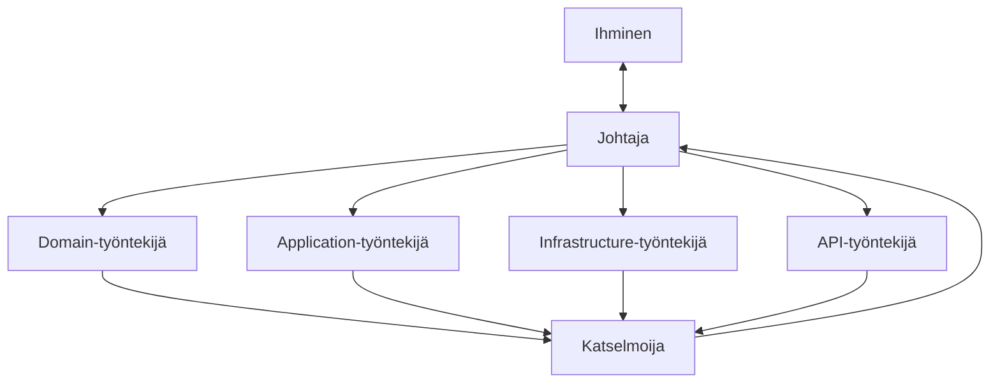

# AGENTS.md — tenttijärjestelmä

Tämä repo on kuvaus ennen koodia. Tämä tiedosto koskee jokaista agenttia roolista riippumatta. Roolikohtaiset rajat ovat `docs/agentit.md`:ssä.

## Lue tässä järjestyksessä

1. `docs/domain.md` — kieli, säännöt ja kenen vastuulla kukin sääntö on
2. `docs/arkkitehtuuri.md` — osat, riippuvuuden suunta, kiellot, ei-tavoitteet
3. `docs/rajapinta.md` — reitit, kentät sanoina, statuskoodit
4. `docs/testaus.md` — testiaineisto, kiinteä kello ajossa, kriteerien ajo, kattavuusmatriisi, kuka ajaa mitäkin
5. `docs/versiohallinta.md` — haarat, commit, pull request, mitä ei repoon, miten sessio päättyy
6. `docs/agentit.md` — oma roolisi: mitä luet, mitä saat muuttaa, mitä palautat
7. `docs/adr/` — tehdyt rakennepäätökset
8. Se `specs/NNN-*.md`, jota pyydetty muutos koskee, ja vain sen **Tehtävät**-osion pyydetty askel
9. `docs/tilaus.md` ja `docs/havainnot.md` — asiakkaan sanat ja oletukset; näihin palataan, kun jokin tuntuu puuttuvan

Työntekijä lukee kohdat 1–8 vain siltä osin kuin `docs/agentit.md` sen roolille sallii. Johtaja ja katselmoija lukevat kaiken.

## Roolit

- **Johtaja** on ainoa, joka puhuu ihmiselle, tekee git-toimia ja jakaa työtä. Johtaja ei kirjoita koodia itse.
- **Työntekijä** saa yhden Tehtävät-askeleen ja kirjoittaa vain oman kerroksensa projektiin ja sen testiprojektiin. Se palauttaa muutetut tiedostot, testien tulosteen ja kysymykset johtajalle.
- **Katselmoija** lukee diffin `docs/domain.md`:n Paikka-saraketta, `docs/arkkitehtuuri.md`:n kieltoja ja specin kriteerejä vasten. Se ei muuta tiedostoja; se palauttaa löytölistan. Tyhjä lista on hyväksyntä.
- Samaan projektiin kirjoittaa kerrallaan yksi työntekijä. Askel, joka koskee kahta kerrosta, jaetaan kahdeksi peräkkäiseksi tehtäväksi.

## Ensin suunnitelma

Ennen kuin yhtään tiedostoa muutetaan, johtaja esittää suunnitelman pyydetylle askeleelle: mitkä tiedostot luodaan tai muutetaan, mikä rooli tekee minkä osan, missä kerroksessa kukin sääntö tarkistetaan (viittaus `domain.md`:n riviin), mitkä testit kirjoitetaan ja miten valmius todetaan. Johtaja odottaa ihmisen hyväksyntää ennen ensimmäistä tehtävänantoa.

## Älä

- Älä keksi käsitettä, projektia, reittiä, roolia tai haaraa, jota kuvaus ei nimeä.
- Älä aloita tutoriaalista äläkä yleisestä Clean Architecture -pohjasta. Projektit ovat `docs/arkkitehtuuri.md`:n neljä, ei enempää.
- Älä tee useampaa tehtävälistan askelta yhdellä kertaa, äläkä anna samaa askelta kahdelle työntekijälle.
- Älä kutsu kelloa Domainissa. Aika annetaan parametrina (ks. ADR 0001).
- Älä muuta `docs/`- tai `specs/`-tiedostoa työntekijänä. Kuvauksen muutos on johtajan ja ihmisen asia ja oma commit.
- Älä commitoi, pushaa tai yhdistä pull requestia muuna kuin johtajana. Pull requestin yhdistää aina ihminen.

## Pysähdy ja kysy, jos

- säännöllä ei ole Paikkaa `docs/domain.md`:ssä
- spec on ristiriidassa `docs/`-tiedostojen kanssa
- `docs/havainnot.md`:n **Avoimet**-kohta koskee tehtävää, jota teet
- joudut valitsemaan statuskoodin, kentän nimen tai kirjaston, jota `docs/rajapinta.md` tai `docs/arkkitehtuuri.md` ei mainitse
- askel vaatii kirjoittamista projektiin, johon roolisi ei saa kirjoittaa

Työntekijä kysyy johtajalta, johtaja ihmiseltä. Työntekijä ei arvaa eikä kysy ihmiseltä suoraan. Arvaus näyttää aivan koodilta; kysymys on halvempi.

## Tarkistukset

- Käännös: `dotnet build` repon juuressa, ei varoituksia väärästä projektiviittauksesta.
- Testit: `dotnet test` — Domain-testit eivät käynnistä web-palvelinta eivätkä avaa tietokantaa.
- Hyväksymiskriteerit: specin Given–When–Then-rivit ajetaan HTTP-kutsuina käynnissä olevaa APIa vasten `docs/testaus.md`:n aineistolla ja kellolla. Ihminen ajaa ne; "valmis" ilman ajoa ei kelpaa.

## Definition of Done (sama joka askeleelle)

Askeleen kriteerit ajettu · katselmoija palauttanut tyhjän löytölistan · jokaiselle askeleen säännölle testi · yksi commit per askel, viesti asiakkaan sanoin · ei tietokantatiedostoa, käännöstulosta eikä tokenia repossa · johtajan lopetusviesti `docs/versiohallinta.md`:n muodossa: haara, commitit, ajettujen tarkistusten tuloste, avoimet kysymykset.
